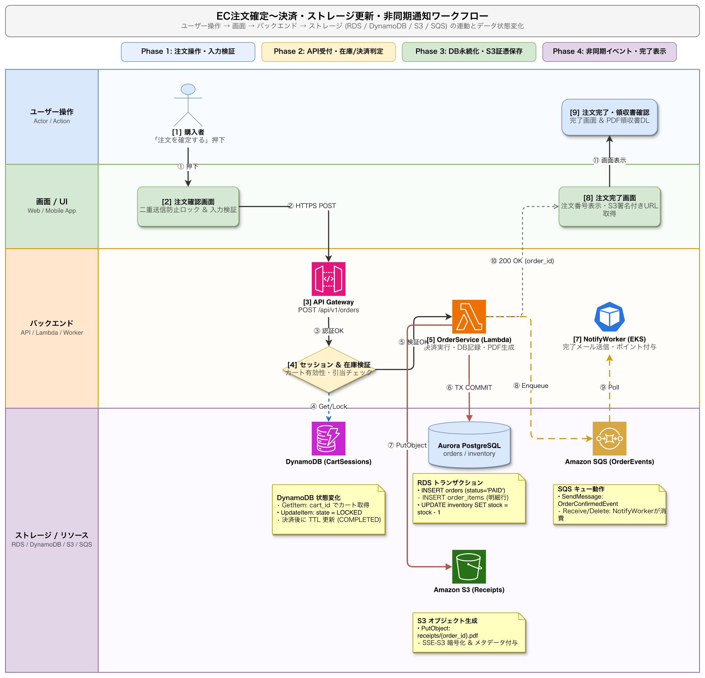
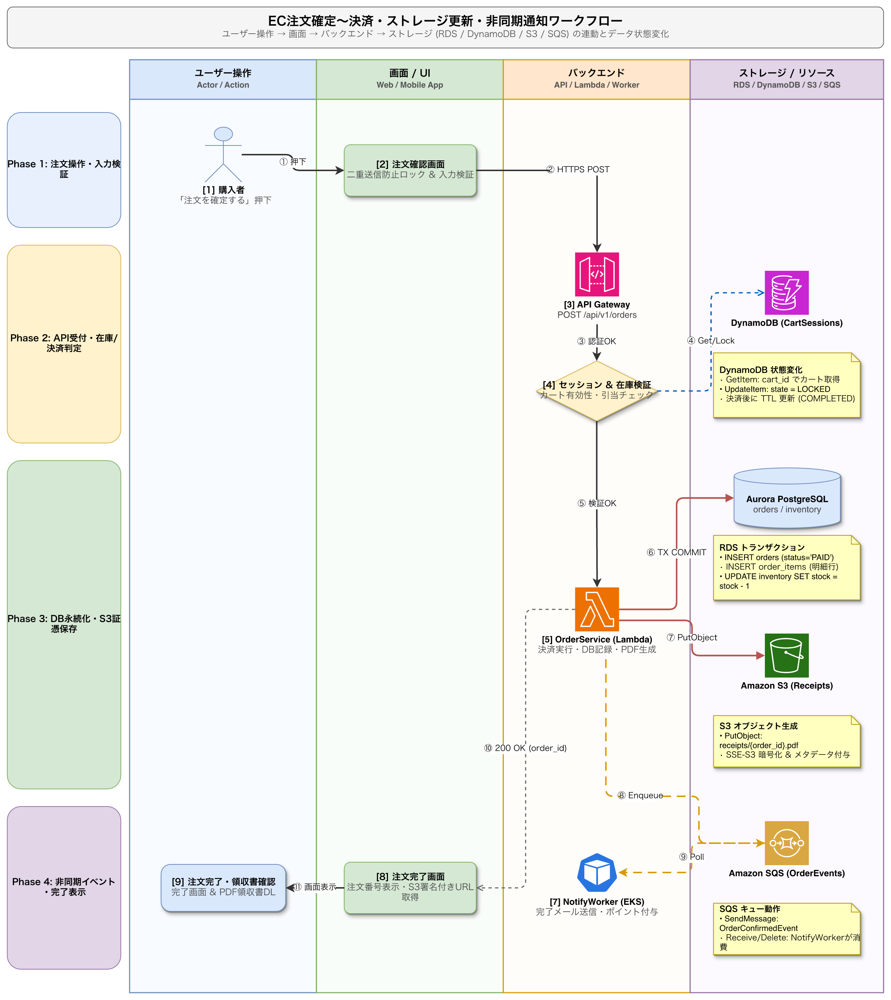

# drawio-workflow-skill

> **Disclaimer**: This is an independent, unofficial open-source agent skill and is **not** affiliated with, endorsed by, or sponsored by draw.io Ltd (JGraph) or draw.io AG. `draw.io` is a registered trademark of draw.io AG.

作業フロー（ワークフロー・業務フロー・画面遷移〜API〜ストレージ連動フロー）を、**横スイムレーン / 縦スイムレーン付き draw.io 図面（`.drawio` + `.drawio.png`）** として自動生成・PNG変換する **Node.js のみ・`npm install` 不要** のエージェントスキルです。

- **横方向・縦方向スイムレーン両対応**: `--direction horizontal`（左→右に時系列） / `--direction vertical`（上→下に時系列）を同じ JSON 仕様から切り替え可能
- **ユーザー確認ベースのレーン設計**: スキル起動時にスイムレーンの向きと作成するレーン構成（`ユーザー操作`, `画面 / UI`, `バックエンド`, `ストレージ / リソース`, `外部サービス` 等）をユーザーに確認してから生成
- **関連リソースの動作可視化**: 各ストレージ（RDS / S3 / DynamoDB / SQS / Redis 等）に対して「何が起きるか（`INSERT / UPDATE`、`PutObject`、`GetItem / TTL更新`、`SendMessage` 等）」を矢印種別（`write` / `read` / `async` / `response`）と状態変化ノートで表現
- **ブラウザ不要・ゼロ依存・Node.js のみで動作**: [drawio-mjs](https://github.com/NagasakaH/drawio-mjs) の単一ファイルバンドル（`scripts/drawio2png.mjs`）を同梱しており、`npm install` や `draw.io.app` なしで `.drawio.png`（元XML埋め込み済み・draw.io再編集可能）を生成

---

## インストール（グローバルスキル登録）

**`npm install` は不要です**（Node.js v18+ があればそのまま動作します）。

```bash
git clone https://github.com/NagasakaH/drawio-workflow-skill.git
mkdir -p ~/.agents/skills ~/.gemini/config/skills
ln -sfn "$(pwd)/drawio-workflow-skill" ~/.agents/skills/drawio-workflow
ln -sfn "$(pwd)/drawio-workflow-skill" ~/.gemini/config/skills/drawio-workflow
```

---

## 使い方

### 1. JSON 仕様からスイムレーン図（`.drawio` + `.drawio.png`）を一括生成

```bash
# 横スイムレーン（左→右）
node scripts/build-workflow.mjs \
  --spec examples/order-checkout-workflow.json \
  --direction horizontal \
  --output examples/output/order-checkout-workflow.drawio.png

# 縦スイムレーン（上→下）
node scripts/build-workflow.mjs \
  --spec examples/order-checkout-workflow.json \
  --direction vertical \
  --output examples/output/order-checkout-workflow-vertical.drawio.png
```

### 2. `.drawio` XML を直接 PNG / SVG に変換

```bash
node scripts/drawio2png.mjs input.drawio -o output.drawio.png --scale 2 --border 16
```

---

## 生成サンプル

| 横スイムレーン (`--direction horizontal`) | 縦スイムレーン (`--direction vertical`) |
|---|---|
|  |  |

---

## ディレクトリ構成

- [`SKILL.md`](SKILL.md) — エージェントスキル定義（事前確認フロー・設計ルール・実行手順）
- [`scripts/build-workflow.mjs`](scripts/build-workflow.mjs) — JSON ワークフロー仕様 → 横/縦スイムレーン `.drawio` XML + `.drawio.png` 自動生成スクリプト
- [`scripts/drawio2png.mjs`](scripts/drawio2png.mjs) — 単一ファイル完結の Pure Node.js draw.io XML → PNG/SVG コンバーター
- [`references/workflow-schema.md`](references/workflow-schema.md) — JSON スキーマリファレンス
- [`references/swimlane-xml-guide.md`](references/swimlane-xml-guide.md) — `.drawio` XML 直接記述ガイド
- [`examples/order-checkout-workflow.json`](examples/order-checkout-workflow.json) — EC注文確定ワークフローのサンプル仕様

---

## ライセンス・注意事項

- 本リポジトリのコードは **[Apache License 2.0](LICENSE)** の下で提供されています（詳細は [`LICENSE`](LICENSE) および [`NOTICE`](NOTICE) を参照）。
- 同梱の `scripts/drawio2png.mjs`（[drawio-mjs](https://github.com/NagasakaH/drawio-mjs) 由来）には draw.io OSS（Apache-2.0）および `@resvg/resvg-wasm`（MPL-2.0）が含まれます。
- **ステンシル・アイコンに関する制限**: draw.io 本家の `stencils/LICENSE` / `shapes/LICENSE` に基づき、同梱のアイコン・ステンシルアセットを **Atlassian 製品や Atlassian Marketplace プラグインへ組み込み・配布することは禁止**されています（本ツールで出力した PNG / SVG 図面自体の利用には制限はありません）。
